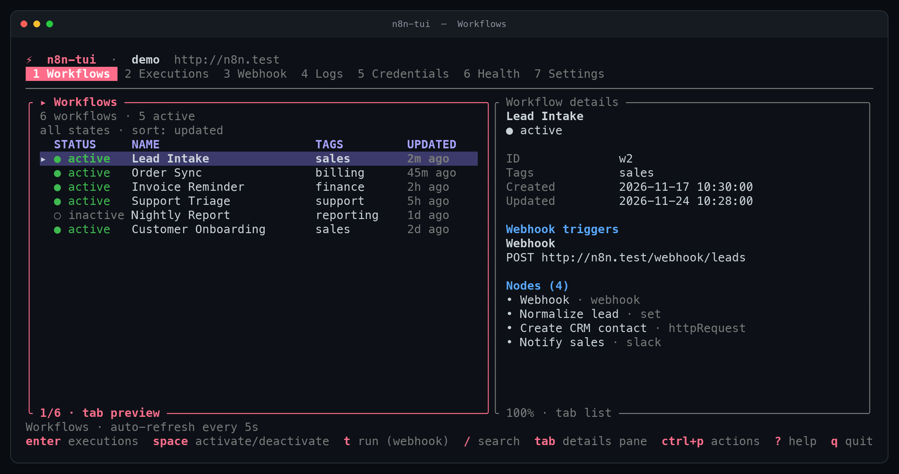
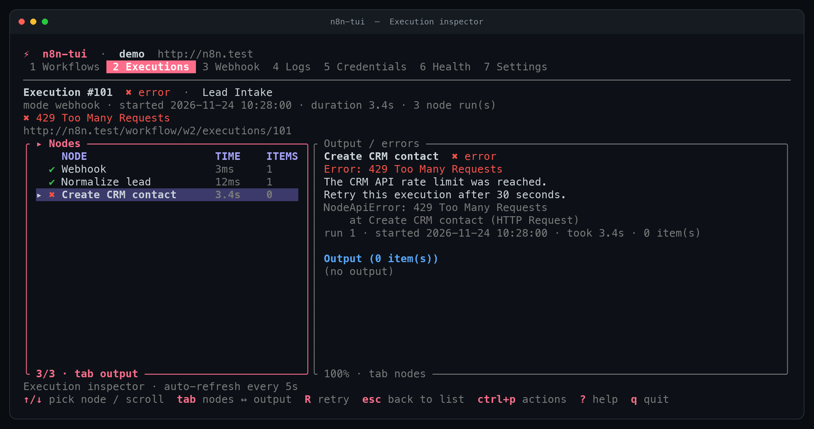
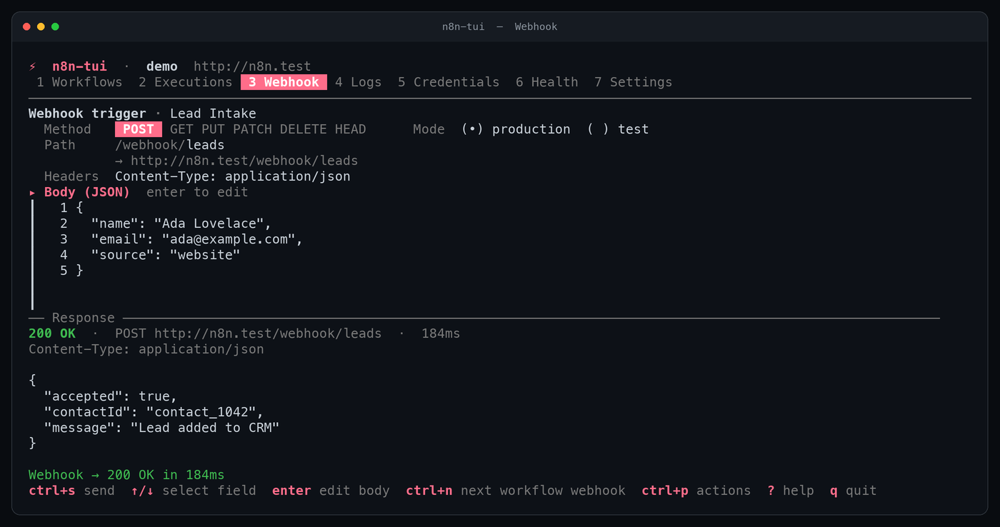

# n8n-tui

**A fast, keyboard-driven terminal app for [n8n](https://n8n.io).**

https://github.com/user-attachments/assets/b8c18eae-3540-459d-b6c5-7e327f91b506

Look after your n8n workflows without opening a browser:

- See every workflow, and switch any of them on or off with one key.
- Browse execution history and open any run to see exactly what each node did, including the error on the node that failed.
- Fire a workflow's webhook with your own JSON payload and read the response.
- Watch executions stream in live as they run.
- Check whether the instance, its database and your API key are all healthy.
- Switch between several n8n instances (production, staging, local…).

It's a single binary with nothing else to install. It starts instantly and only talks to n8n's official REST API.



*Screenshots show the app rendered with sample data.*

---

**Contents:**

- [Quick start](#quick-start)
- [A two-minute tour](#a-two-minute-tour)
- [The views](#the-views)
- [Keyboard shortcuts](#keyboard-shortcuts)
- [Configuration](#configuration)
- [Troubleshooting](#troubleshooting)
- [What n8n-tui can and can't do](#what-n8n-tui-can-and-cant-do)
- [Development](#development)

---

## Quick start

### 1. Install

**Download a binary (no Go installation needed):** open the
[latest release](https://github.com/kaypee90/n8n-tui/releases/latest) and choose
the archive matching your system:

| System | Archive suffix |
|--------|----------------|
| macOS, Apple Silicon | `darwin_arm64.tar.gz` |
| macOS, Intel | `darwin_amd64.tar.gz` |
| Linux, Intel/AMD 64-bit | `linux_amd64.tar.gz` |
| Linux, ARM64 | `linux_arm64.tar.gz` |
| Windows, Intel/AMD 64-bit | `windows_amd64.zip` |
| Windows, ARM64 | `windows_arm64.zip` |

Download an archive from the release's **Assets** list, rather than GitHub's
automatic **Source code** archives. `amd64` means Intel/AMD 64-bit; `arm64` means
Apple Silicon or another 64-bit ARM CPU. On macOS/Linux, `uname -m` reports
`x86_64` for `amd64` and `arm64` or `aarch64` for `arm64`.

Each archive includes the executable, README and license. The examples below use
`0.1.0`; replace the filename with the version and platform you downloaded.

<details>
<summary>Install on macOS or Linux</summary>

In the directory containing the downloaded archive, extract it and install the
binary in your user's executable directory. This example is for an Apple
Silicon Mac; use the matching filename from the table for other systems:

```sh
tar -xzf n8n-tui_0.1.0_darwin_arm64.tar.gz
mkdir -p "$HOME/.local/bin"
install -m 755 n8n-tui "$HOME/.local/bin/n8n-tui"
export PATH="$HOME/.local/bin:$PATH"
n8n-tui --version
```

Add `export PATH="$HOME/.local/bin:$PATH"` to your shell startup file, such as
`~/.zshrc` or `~/.bashrc`, to keep the command available in new terminals.
You can also run the extracted binary directly with `./n8n-tui`.
</details>

<details>
<summary>Install on Windows (PowerShell)</summary>

In the directory containing the downloaded ZIP, extract it and run the executable:

```powershell
Expand-Archive .\n8n-tui_0.1.0_windows_amd64.zip -DestinationPath .\n8n-tui
Set-Location .\n8n-tui
.\n8n-tui.exe --version
```

To run `n8n-tui` from any directory, move the extracted folder to a permanent
location and add that folder to your **user Path** environment variable (search
Windows for **Edit environment variables for your account**). Open a new
terminal after changing Path. Without a Path change, run `.\n8n-tui.exe init`
and `.\n8n-tui.exe` from the extracted folder for setup and normal use.
</details>

<details>
<summary>Verify a download or upgrade an existing installation</summary>

Download `checksums.txt` from the **same release** as your archive. Compute the
archive's SHA-256 hash and compare it with that filename's entry in the file:

- **macOS:** `shasum -a 256 n8n-tui_0.1.0_darwin_arm64.tar.gz`
- **Linux:** `sha256sum n8n-tui_0.1.0_linux_amd64.tar.gz`
- **PowerShell:** `Get-FileHash .\n8n-tui_0.1.0_windows_amd64.zip -Algorithm SHA256`

To upgrade, quit n8n-tui, download and extract the newer archive for your system,
then replace the installed executable. Run `n8n-tui --version` to confirm the
update. Your configuration is stored separately and is preserved; you do not
need to run `init` again.
</details>

**Or install with Go 1.24 or newer:**

```sh
go install github.com/kaypee90/n8n-tui/cmd/n8n-tui@latest
```

This puts `n8n-tui` in `$(go env GOPATH)/bin`. Make sure that directory is on your `PATH`.

<details>
<summary>Or build from source</summary>

```sh
git clone https://github.com/kaypee90/n8n-tui.git
cd n8n-tui
CGO_ENABLED=0 go build -ldflags "-s -w -X main.version=$(git describe --tags --always)" -o n8n-tui ./cmd/n8n-tui
./n8n-tui --version
```

The result is a single static binary. It runs on Linux, macOS and Windows (native terminals or WSL). Set `GOOS`/`GOARCH` to cross-compile.
</details>

### 2. Create an n8n API key

In the n8n web app, open **Settings → n8n API** and click **Create an API key**. Copy the key: n8n only shows it once.

> No n8n instance to try this on? Start one locally with Docker:
> ```sh
> docker run -it --rm -p 5678:5678 docker.n8n.io/n8nio/n8n
> ```
> Then open http://localhost:5678, create the owner account, and create the API key.

### 3. Connect

Run the setup wizard. It asks for your n8n address and API key, checks that they work, and saves them:

```sh
n8n-tui init
```

Then start the app:

```sh
n8n-tui
```

If you run `n8n-tui` before setting anything up, it offers to start the wizard for you.

> **Just trying it out?** Skip the config file and pass the details as environment variables:
> ```sh
> N8N_URL=http://localhost:5678 N8N_API_KEY=your-key n8n-tui
> ```

---

## A two-minute tour

When n8n-tui starts you see the **Workflows** view shown above:

- **Header (top):** the instance you're connected to, and the seven views. Press a number to jump to one.
- **Main area:** the current view. The pane with the highlighted border and `▸` has focus.
- **Footer (bottom):** the latest message, then the most useful keys *for this view*. You don't need to memorise anything: the footer always tells you what you can do.

Try this:

1. Move with **↑/↓** (or `j`/`k`). The right-hand pane shows the selected workflow.
2. Press **enter** to see that workflow's executions.
3. Press **enter** on an execution to open the **inspector**. The node that failed is already selected, with its error on the right.
4. Press **esc** to go back.
5. Press **?** at any time for every shortcut in the current view, or **ctrl+p** and type what you want to do (for example `health` or `delete`).
6. Press **q** to quit.

Anything that deletes data asks first, and only **y** confirms. `enter`, `n` and `esc` all cancel.

---

## The views

### 1 · Workflows

Every workflow on the instance, with its status, tags, whether it has a webhook trigger, and when it was last changed. The right-hand pane shows the selected workflow's details, its webhook URLs and its nodes.

| Key | What it does |
|-----|--------------|
| `enter` / `e` | Show this workflow's executions |
| `space` | Activate or deactivate the workflow |
| `t` | Run the workflow now, through its Webhook trigger node (see [limits](#what-n8n-tui-can-and-cant-do)) |
| `w` | Open the workflow in the Webhook view to send a custom payload |
| `/` | Search by name, tag or ID. `enter` keeps the filter, `esc` clears it |
| `f` | Show all, only active, or only inactive workflows |
| `o` | Sort by last update or by name |
| `d` | Delete the workflow (asks for confirmation) |
| `tab` | Move focus to the details pane, to scroll it |

### 2 · Executions

Workflow runs, newest first: status, workflow, how it was started (mode), start time and duration. Older runs load automatically as you scroll down.

| Key | What it does |
|-----|--------------|
| `enter` | Open the execution in the inspector |
| `f` | Filter by status: error, success, running, waiting, canceled |
| `a` | Show executions of all workflows (after opening one workflow's list) |
| `R` | Retry a failed or canceled execution |
| `d` | Delete the execution (asks for confirmation) |

The list refreshes itself, but stops once you have scrolled back through more than 250 runs, so older pages don't move under you. Press `r` to jump back to the newest runs.

### Execution inspector

Opened with `enter` from the Executions view. The top of the screen summarises the run and gives a link to open it in the n8n editor. Below that:

- **Left pane:** every node that ran, with its status, run time and number of output items.
- **Right pane:** the selected node's output as formatted JSON, or its error message, description and stack trace.

The first failing node is selected for you. While an execution is still running, the inspector keeps updating it without losing your selection or scroll position.



| Key | What it does |
|-----|--------------|
| `↑/↓` | Pick a node (left pane) or scroll the output (right pane) |
| `tab` / `enter` | Switch between the node list and the output |
| `R` | Retry this execution; the inspector then shows the new run |
| `esc` | Back to the execution list |

### 3 · Webhook

A small HTTP client for calling a workflow's Webhook trigger node with your own payload.

1. Press `ctrl+n` to fill in the webhook of one of your workflows (press again for the next one). You can also press `w` on the Workflows view.
2. Move between the fields with `↑/↓`. Press `enter` to edit a text field and `esc` to stop editing. On **Method** and **Mode**, `←/→` (or `enter`) changes the value.
3. Press `ctrl+s` to send. The status, headers and response body appear at the bottom. Scroll them with `pgup`/`pgdown`.



| Field | Meaning |
|-------|---------|
| Method | HTTP method: POST, GET, PUT, PATCH, DELETE or HEAD |
| Mode | **production** calls `/webhook/<path>` and only works while the workflow is active. **test** calls `/webhook-test/<path>` and only works while *Listen for test event* is running in the n8n editor |
| Path | The Webhook node's path. The full URL is shown underneath |
| Headers | Optional extra headers, e.g. `X-Token: abc; X-Env: dev` |
| Body | The JSON payload. It is checked before sending. To send something other than JSON, add a `Content-Type` header |

The field you're typing in is marked `✎`. While you type, single-letter shortcuts are turned off so they can't fire by accident. Press `esc` to stop typing, and they work again.

### 4 · Logs

A live feed of activity on the instance: a line when an execution starts, one for each node as it finishes (with its timing), and the final result. Failed nodes include their error message.

The feed keeps updating in the background while you use other views, so you can trigger a workflow and come back to watch it.

| Key | What it does |
|-----|--------------|
| `p` | Pause or resume the feed |
| `x` | Clear the screen |
| `↑/↓` | Scroll back. The feed stops following new lines while you do |
| `G` | Jump to the newest line and follow again |

### 5 · Credentials

The credentials stored in n8n (names and types only: n8n's API never returns their secret values) and your instance variables. Variable values are masked until you press `v`.

Some n8n versions and licences don't offer these lists. If yours doesn't, the view says so, and everything else keeps working.

| Key | What it does |
|-----|--------------|
| `tab` | Switch between credentials and variables |
| `v` | Show or hide variable values |

### 6 · Health

**Start here when something isn't working.** This view checks each part of the connection separately:

| Check | What it tells you |
|-------|-------------------|
| Process | n8n is up and answering (`/healthz`) |
| Database | n8n's database (and Redis, in queue mode) is connected (`/healthz/readiness`) |
| Public API | Your API key is accepted |
| Latency | How long n8n takes to answer |
| Version / execution mode | Shown when the instance exposes them |
| Running / Waiting | How many executions are in progress or paused right now |

### 7 · Settings

The instances in your config file, plus the settings that are in effect. Select an instance and press `enter` to switch to it. To add or change instances, edit the config file (or run `n8n-tui init` again) and restart n8n-tui.

---

## Keyboard shortcuts

These work everywhere, except while you're typing in a text field (press `esc` to stop typing first):

| Key | What it does |
|-----|--------------|
| `1` … `7` | Jump to a view |
| `[` / `]` | Previous / next view |
| `ctrl+p` | Search every action and view by name |
| `?` | Help for the current view |
| `!` | Show the full last message. For errors this includes how to fix the problem |
| `r` | Refresh now |
| `esc` | Step back: close a dialog, leave the details pane, clear a search; then return to the list from the inspector, or to Workflows from any other view |
| `↑/↓` or `j/k` | Move or scroll |
| `g` / `G`, `home` / `end` | First / last row |
| `pgup` / `pgdown`, `ctrl+u` / `ctrl+d` | Page / half page |
| `e` | Executions (of the selected workflow, if there is one) |
| `w` | Webhook view (pre-filled from the selected workflow) |
| `l` · `c` · `h` · `s` | Logs · Credentials · Health · Settings |
| `q` | Quit (`ctrl+c` always quits, even while typing) |

Each view's own keys are listed under [The views](#the-views), in the footer, and in `?`.

### Good to know

- **Any terminal size works.** Wide terminals show panes side by side, narrow ones stack them, and short ones show only the focused pane (`tab` reaches the other one). Tables drop less important columns first. The minimum is 40 × 12; 100 × 30 or larger is most comfortable.
- **Works without colour.** Selection (`▸`), focus and status are always shown with symbols too.
- **You keep your place.** Auto-refresh keeps the selected workflow, node and scroll position.
- **Errors stay put.** Error messages stay in the footer until something replaces them, and a failed refresh keeps the data you already have on screen.

---

## Configuration

### Where the config lives

`~/.config/n8n-tui/config.yaml`, or `$XDG_CONFIG_HOME/n8n-tui/config.yaml` when that variable is set. Use `--config <file>` to load a different one.

The easiest way to create it is `n8n-tui init`, which writes YAML (so a `--config` path given to `init` must end in `.yaml`). If the file already exists, `init` leaves it alone and prints the lines to add instead. JSON (`.json`) and TOML (`.toml`) files also work if you write them yourself. To start from a commented template instead:

```sh
mkdir -p ~/.config/n8n-tui
n8n-tui --example-config > ~/.config/n8n-tui/config.yaml
chmod 600 ~/.config/n8n-tui/config.yaml
```

### Example

```yaml
instances:
  - name: production
    url: https://n8n.example.com
    api_key: ${N8N_API_KEY}            # read from the environment variable N8N_API_KEY

  - name: staging
    url: https://n8n-staging.example.com
    api_key: ${N8N_STAGING_API_KEY}

  - name: local
    url: http://localhost:5678
    api_key: n8n_api_0123456789abcdef  # a literal key is fine if the file is chmod 600

default_instance: production
refresh_interval: 5s
timeout: 10s
```

### Settings

**Per instance:**

| Setting | Required | Description |
|---------|----------|-------------|
| `name` | yes | Any name you like. Used with `--instance` and shown in the header |
| `url` | yes | The address you open n8n at, e.g. `https://n8n.example.com`. Don't add `/api/v1`; n8n-tui adds it |
| `api_key` | yes\* | An n8n API key (Settings → n8n API) |
| `username`, `password` | no | Basic-auth credentials, for when a reverse proxy in front of n8n asks for a password |
| `webhook_url` | no | Base URL for webhooks, if they're served from a different host (n8n's `WEBHOOK_URL` setting, or queue-mode webhook processors) |
| `insecure_skip_verify` | no | `true` accepts self-signed TLS certificates. Only use this for local or dev instances |

\* Only basic auth (`username`/`password`) can stand in for an API key, and then most features won't work, because n8n's API needs a key.

**Top level:**

| Setting | Default | Description |
|---------|---------|-------------|
| `default_instance` | first instance | The instance to connect to when you don't pass `--instance` |
| `refresh_interval` | `5s` | How often views and the log stream check n8n for changes (minimum `500ms`) |
| `timeout` | `10s` | How long to wait for each request before giving up |

### Keeping secrets out of the file

Any value can reference an environment variable as `${NAME}`. The variable is read when n8n-tui starts, so the key itself never has to be written down:

```sh
export N8N_API_KEY='…'   # e.g. in ~/.zshrc, or loaded from your password manager
n8n-tui
```

If you do write a key directly into the file, n8n-tui warns you on startup while the file is readable by other users. Run `chmod 600` on it; `n8n-tui init` does this for you. Values can reference environment variables as `${NAME}`, so a key that itself contains `$` has to come from an environment variable (`init` handles this for you). Keys are always masked inside the app, and your API key is never sent to webhook URLs.

### Environment variables only

Without a config file, n8n-tui connects using:

| Variable | Description |
|----------|-------------|
| `N8N_URL` | Instance URL (required) |
| `N8N_API_KEY` | API key |
| `N8N_USERNAME`, `N8N_PASSWORD` | Optional basic auth |

### Command-line options

```
n8n-tui                        open the app on the default instance
n8n-tui --instance staging     open the app on another configured instance
n8n-tui --config ./dev.yaml    use a different config file
n8n-tui init                   set up a connection (never overwrites an existing config)
n8n-tui --example-config       print a commented config template
n8n-tui --version              print the version
n8n-tui -h                     show help
```

---

## Troubleshooting

When something fails, the footer says what went wrong in plain language. Press **`!`** for the full message, including how to fix it. The **Health** view (`6`) checks each part of the connection one by one.

| You see | What it means | What to do |
|---------|---------------|------------|
| *n8n rejected the API key* | The key is wrong, was revoked, or the environment variable it comes from isn't set | Create a new key under **Settings → n8n API**. If the config says `${N8N_API_KEY}`, run `echo $N8N_API_KEY` in the same shell to check it's set |
| *The n8n public API was not found at this URL* | The URL doesn't point at n8n's root, or the public API is disabled | Use the address you open n8n at (no `/api/v1`, no `/home/workflows`). Self-hosters: make sure `N8N_PUBLIC_API_DISABLED` isn't `true` |
| *Connection refused* | Nothing is listening at that address | Check that n8n is running, and the host and port in `url` |
| *Host could not be found* | The hostname doesn't resolve | Look for a typo in `url`, or check your VPN or DNS |
| *TLS certificate is not trusted* | The instance uses a self-signed or private certificate | Install the certificate, or set `insecure_skip_verify: true` for dev instances |
| *n8n did not respond in time* | Slow network or overloaded instance | Check the Health view's latency; raise `timeout` |
| *The API key is not allowed to do this* | The key lacks a scope, or the feature needs a licence | Use a key from an owner or admin account, or with the needed scopes |
| `t` says the workflow *has no Webhook trigger node* | n8n's API can only start workflows through a webhook | Add a **Webhook** trigger node to the workflow in n8n |
| `t` says the workflow *is inactive* | Production webhooks only answer for active workflows | Press `space` to activate it, or use the Webhook view in **test** mode |
| Webhook view returns **404** | The webhook isn't registered right now | **production:** activate the workflow. **test:** click *Listen for test event* in the n8n editor first |
| *Retry is not supported by this n8n version* | Retrying through the API needs n8n 1.83 or newer | Upgrade n8n, or retry from the n8n editor |
| Credentials/Variables *aren't available* | Your n8n version or licence doesn't offer them | Nothing to fix. The rest of the app works normally |
| Keys type text instead of doing things | You're editing a text field (marked `✎`) | Press `esc` to stop editing |
| *Terminal too small* | The window is smaller than 40×12 | Make the window bigger. Only `q` and `ctrl+c` work until you do |

---

## What n8n-tui can and can't do

n8n-tui only uses n8n's **public REST API** (`/api/v1`, authenticated with the `X-N8N-API-KEY` header), plus a few unauthenticated health endpoints. That brings some limits:

- **Running workflows.** The public API has no "run this workflow" endpoint, so `t` calls the workflow's **Webhook** trigger node instead. Workflows with other triggers (schedule, manual, app events) can't be started from n8n-tui. Production webhooks need the workflow to be active. Test webhooks need *Listen for test event* running in the editor.
- **Live logs.** n8n doesn't push execution events to API clients, so the Logs view checks for changes every `refresh_interval`. An execution that starts and finishes between two checks shows up all at once.
- **Version and licence differences.** Execution retry needs n8n ≥ 1.83. Credential listing and variables depend on your version and licence. When something isn't available, n8n-tui says so and carries on.
- **Read-only credentials.** n8n never returns credential secrets through the API, so neither does n8n-tui.
- **Editing workflows.** n8n-tui doesn't edit workflow definitions. Use the n8n editor for that; the inspector shows a link to each execution there.

<details>
<summary>API endpoints used</summary>

| Feature | Endpoint |
|---------|----------|
| Workflows | `GET /workflows`, `POST /workflows/{id}/activate`, `POST /workflows/{id}/deactivate`, `DELETE /workflows/{id}` |
| Executions | `GET /executions`, `GET /executions/{id}?includeData=true`, `DELETE /executions/{id}`, `POST /executions/{id}/retry` |
| Credentials / variables | `GET /credentials`, `GET /variables` |
| Webhooks | `{url}/webhook/{path}`, `{url}/webhook-test/{path}` (sent without your API key) |
| Health | `GET /healthz`, `GET /healthz/readiness`, `GET /rest/settings` (version and mode, when exposed) |
</details>

---

## Development

The [CI workflow](https://github.com/kaypee90/n8n-tui/blob/main/.github/workflows/ci.yml) runs on every pull request and push to
`main`. It builds all Go packages, runs the tests with the race detector, and
runs `go vet`. The release workflow reuses these checks before publishing.

```sh
go run ./cmd/n8n-tui        # run from source
go build ./...             # build all packages
go test -race ./...         # run the tests
go vet ./...
```

Project layout:

```
cmd/n8n-tui/              entry point, flags and the `init` setup wizard
internal/api/             n8n REST client (resty) and plain-language error explanations
internal/config/          config loading (viper), ${ENV} expansion and validation
internal/models/          API types: workflows, executions, per-node run data
internal/tui/             Bubble Tea app, one file per view
internal/tui/components/  table, confirmation dialog, formatting helpers
```

Each view implements the small `screen` interface in `internal/tui/app.go`. API results are delivered to every view, and keys go only to the visible one. Responses from a previous instance are dropped after you switch instances. The TUI tests drive the whole app against a fake client (`internal/tui/app_test.go`), so most behaviour can be tested without a running n8n.

### Publishing a release

The [Release workflow](https://github.com/kaypee90/n8n-tui/blob/main/.github/workflows/release.yml) runs when a version tag
such as `v0.1.0` is pushed. It runs the CI build, race-enabled tests and `go vet`,
then uses [GoReleaser](https://goreleaser.com/) to build all six platform/CPU
combinations, create the archives and checksums, and publish a GitHub Release
with generated release notes. The tag's version is embedded in `--version`.
Tags such as `v0.2.0-rc.1` are automatically marked as prereleases.

After committing and pushing the release workflow and the changes you want to
ship, tag that commit and push the tag:

```sh
git tag -a v0.1.0 -m "Release v0.1.0"
git push origin v0.1.0
```

Follow the run in the repository's **Actions** tab. When it finishes, downloads
appear under [Releases](https://github.com/kaypee90/n8n-tui/releases). The workflow
uses GitHub's automatic `GITHUB_TOKEN`; no additional secret is needed. GitHub
Actions must be enabled, and the repository must be public for anyone to access
the downloads.

To check the packaging locally, install GoReleaser **v2.20.3** (the version pinned
in the workflow), then run:

```sh
goreleaser check
goreleaser release --snapshot --clean
```

This creates preview archives and checksums in the ignored `dist/` directory
without publishing a release or creating a tag.
